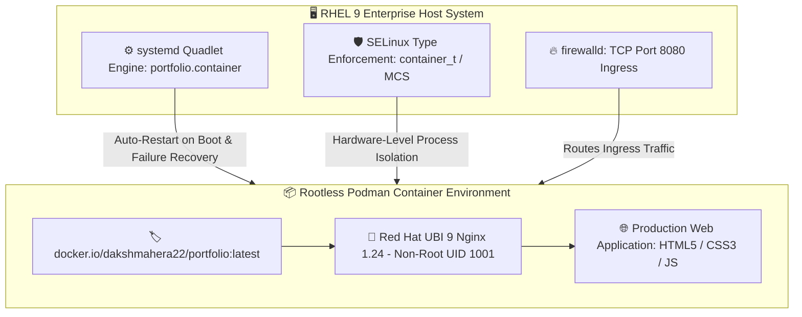

&lt;div align=&quot;center&quot;&gt;


# 🚀 Enterprise Rootless Portfolio Container on RHEL 9

[Docker Pulls](https://www.google.com/search?q=https%3A%2F%2Fhub.docker.com%2Fr%2Fdakshmahera22%2Fportfolio)
[Red Hat RCAT](https://www.google.com/search?q=https%3A%2F%2Fwww.redhat.com%2F)
[RHEL 9](https://www.google.com/search?q=https%3A%2F%2Fdocs.redhat.com%2Fen%2Fdocumentation%2Fred_hat_enterprise_linux%2F9%2Fhtml%2Fbuilding_running_and_managing_containers%2Fassembly_starting-with-containers_building-running-and-managing-containers)
[Podman](https://www.google.com/search?q=https%3A%2F%2Fpodman.io%2F)
[Nginx](https://www.google.com/search?q=https%3A%2F%2Fcatalog.redhat.com%2Fsoftware%2Fcontainers%2Fubi9%2Fnginx-124%2F657b066b6c1bc124a1d7ff39)
[systemd](https://www.google.com/search?q=https%3A%2F%2Fdocs.redhat.com%2Fen%2Fdocumentation%2Fred_hat_enterprise_linux%2F9%2Fhtml%2Fbuilding_running_and_managing_containers%2Fassembly_starting-with-containers_building-running-and-managing-containers)
[SELinux](https://www.google.com/search?q=https%3A%2F%2Fdocs.redhat.com%2Fen%2Fdocumentation%2Fred_hat_enterprise_linux%2F9%2F)
[License](https://www.google.com/search?q=LICENSE)

<br/>

> 🏆 **Capstone Project — Summer Internship 2025**  
> Developed by **Daksh Mahera** during professional training at **Red Hat / RCAT (Rajasthan Centre for Advanced Technology)**.  
> Demonstrates production container engineering, unprivileged user namespaces, SELinux policy enforcement, and declarative service auto-healing on Red Hat Enterprise Linux 9.

&lt;/div&gt;

---

## ⚡ Instant Run — Experience the Portfolio in 5 Seconds

Pull and launch the production container directly from Docker Hub on any Linux, macOS, or Windows machine:

```bash
# 🐳 Run with Docker
docker run -d --name daksh-portfolio -p 8080:8080 dakshmahera22/portfolio:latest

# 🦭 Or Run with Podman (RHEL / Fedora / CentOS)
podman run -d --name daksh-portfolio -p 8080:8080 docker.io/dakshmahera22/portfolio:latest
```

🌐 **Open in Browser:** [http://localhost:8080](https://www.google.com/search?q=http%3A%2F%2Flocalhost%3A8080)  
🔗 **Live Cloud Deployment:** [dakshxmahera.vercel.app](https://www.google.com/search?q=https%3A%2F%2Fdakshxmahera.vercel.app)  
📦 **Docker Hub Image Registry:** [hub.docker.com/r/dakshmahera22/portfolio](https://www.google.com/search?q=https%3A%2F%2Fhub.docker.com%2Fr%2Fdakshmahera22%2Fportfolio)  
💻 **GitHub Source Code:** [github.com/dakshxndrm/podman-portfolio-container](https://www.google.com/search?q=https%3A%2F%2Fgithub.com%2Fdakshxndrm%2Fpodman-portfolio-container)

---

## 🛡️ Why Enterprise RHEL 9 & Podman Over Legacy Docker?

Traditional container runtimes rely on a central daemon running with full `root` privileges. A single container escape can compromise the entire host operating system. This project implements the **Red Hat enterprise gold standard**:

| 🌟 Capability | ⚙️ Technical Mechanism | 💡 Security & Operational Advantage |
| :--- | :--- | :--- |
| **🦭 Daemonless Architecture** | Podman executes directly via OCI runtimes (`runc`/`crun`) without a background daemon socket | Zero daemon attack surface; no single point of failure |
| **👤 Rootless Namespaces** | The entire container runs inside an unprivileged user namespace mapped to UID `1001` | Even if breached, the attacker remains an unprivileged user with zero host access |
| **🔒 SELinux MCS Confinement** | Enforces `container_t` process boundary labels and `:Z` volume relabeling | Blocks host filesystem traversal, socket snooping, and kernel exploitation |
| **🔄 systemd Quadlets** | Declarative `.container` files compiled into native system services on boot | Instant crash auto-restart (`Restart=always`) and seamless system reboot persistence |
| **🏢 Red Hat UBI 9 Runtime** | Built on enterprise-grade [ubi9/nginx-124](https://www.google.com/search?q=https%3A%2F%2Fcatalog.redhat.com%2Fsoftware%2Fcontainers%2Fubi9%2Fnginx-124%2F657b066b6c1bc124a1d7ff39) | Regularly audited CVE patches, minimal footprint, and hardened defaults |

---

## 📐 Architecture & Traffic Flow



---

## 🛠️ Complete Hands-On Tutorial: Build It Yourself on RHEL 9

Follow this field-tested guide to build, containerize, automate, and publish your own portfolio container on Red Hat Enterprise Linux 9.

### Step 1 🚀: Configure RHEL 9 Package Repositories
On a fresh RHEL 9 instance, connect to Red Hat Subscription Manager or configure standard mirrors:
```bash
sudo subscription-manager register --auto-attach
```
*(Or configure free RHEL 9 binary-compatible public mirrors in `/etc/yum.repos.d/` on non-subscribed development machines).*

### Step 2 📦: Install Container Tools & OCI Runtime
```bash
sudo dnf install -y container-tools git firewalld runc
```

### Step 3 📂: Clone the Repository & Setup Structure
```bash
git clone https://github.com/dakshxndrm/podman-portfolio-container.git
cd podman-portfolio-container
mkdir -p nginx systemd src
```
Copy your portfolio frontend files (`index.html`, `assets/`, `*.js`, `*.css`) into `src/`.

### Step 4 🌐: Configure Enterprise Nginx Routing (`nginx/default.conf`)
Red Hat's UBI 9 Nginx includes configuration snippets inside its default `server { ... }` block. Create `nginx/default.conf`:

```nginx
location / {
    root   /opt/app-root/src;
    index  index.html index.htm;
    try_files $uri $uri/ /index.html;
}

# Caching for high-performance static assets
location ~* \.(?:css|js|jpg|jpeg|gif|png|ico|svg|webp|pdf)$ {
    root /opt/app-root/src;
    expires 30d;
    add_header Cache-Control "public, immutable";
}
```

### Step 5 🐳: Craft the Production `Containerfile`
Create `Containerfile` in your repository root:

```dockerfile
FROM registry.access.redhat.com/ubi9/nginx-124:latest

# Copy web files into the official Red Hat UBI 9 web root
COPY src/ /opt/app-root/src/

# Copy custom SPA routing into Nginx default directory
COPY nginx/default.conf /opt/app-root/etc/nginx.default.d/portfolio.conf

# Enforce strict unprivileged execution
USER 1001
EXPOSE 8080

CMD ["nginx", "-g", "daemon off;"]
```

### Step 6 ⚙️: Set Default OCI Runtime to runc
```bash
sudo mkdir -p /etc/containers
cat << 'EOF' | sudo tee /etc/containers/containers.conf
[engine]
runtime = "runc"
EOF
```

### Step 7 🧪: Build and Test the Image Locally
```bash
podman build -t localhost/daksh-portfolio:latest .
podman run -d --name test-portfolio -p 8080:8080 localhost/daksh-portfolio:latest
curl -I http://localhost:8080
podman rm -f test-portfolio
```

### Step 8 🔄: Configure systemd Quadlet Service (Auto-Start at Boot)
RHEL 9's **Quadlets** automatically turn container files into native `systemd` services without fragile bash scripts.

Create `/etc/containers/systemd/portfolio.container`:

```ini
[Unit]
Description=Daksh Mahera Portfolio Container Service
After=network-online.target

[Container]
Image=localhost/daksh-portfolio:latest
ContainerName=daksh-portfolio
PublishPort=8080:8080

[Service]
Restart=always

[Install]
WantedBy=multi-user.target
```

Reload systemd and activate the service:
```bash
sudo systemctl daemon-reload
sudo systemctl enable --now portfolio.service
sudo systemctl status portfolio.service
```

### Step 9 🔥: Open RHEL 9 Firewall Port
```bash
sudo firewall-cmd --permanent --add-port=8080/tcp
sudo firewall-cmd --reload
```

### Step 10 🚀: Publish to Docker Hub
```bash
podman login docker.io
podman tag localhost/daksh-portfolio:latest docker.io/dakshmahera22/portfolio:latest
podman push docker.io/dakshmahera22/portfolio:latest
```

---

## 🔍 Verification & Operations Command Center

| 🎯 Action | 💻 RHEL 9 Command |
| :--- | :--- |
| **Check service health** | `systemctl status portfolio.service` |
| **Stream live container logs** | `journalctl -u portfolio.service -f` |
| **Inspect running containers** | `podman ps` |
| **Verify user namespace UID mapping** | `podman top daksh-portfolio user huser` |
| **Inspect SELinux confinement label** | `ps -eZ \| grep nginx` |
| **Test local HTTP response** | `curl -I http://localhost:8080` |

---

## 👨‍💻 Author & Acknowledgements

&lt;div align=&quot;center&quot;&gt;

**Daksh Mahera**  
*AI/ML · Data Science · RAG Systems · Software Engineering*

[LinkedIn](https://www.google.com/search?q=https%3A%2F%2Fin.linkedin.com%2Fin%2Fdaksh-mahera)
[Portfolio](https://www.google.com/search?q=https%3A%2F%2Fdakshxmahera.vercel.app)
[GitHub](https://www.google.com/search?q=https%3A%2F%2Fgithub.com%2Fdakshxndrm)
[Docker Hub](https://www.google.com/search?q=https%3A%2F%2Fhub.docker.com%2Fr%2Fdakshmahera22%2Fportfolio)

<br/>

🎓 **Project Context:** Completed as part of the **Summer Internship 2025** at **Red Hat / RCAT (Rajasthan Centre for Advanced Technology)**, Jaipur.

&lt;sub&gt;Built with curiosity, careful experiments, and a bias toward shipping useful things.&lt;/sub&gt;


&lt;/div&gt;
