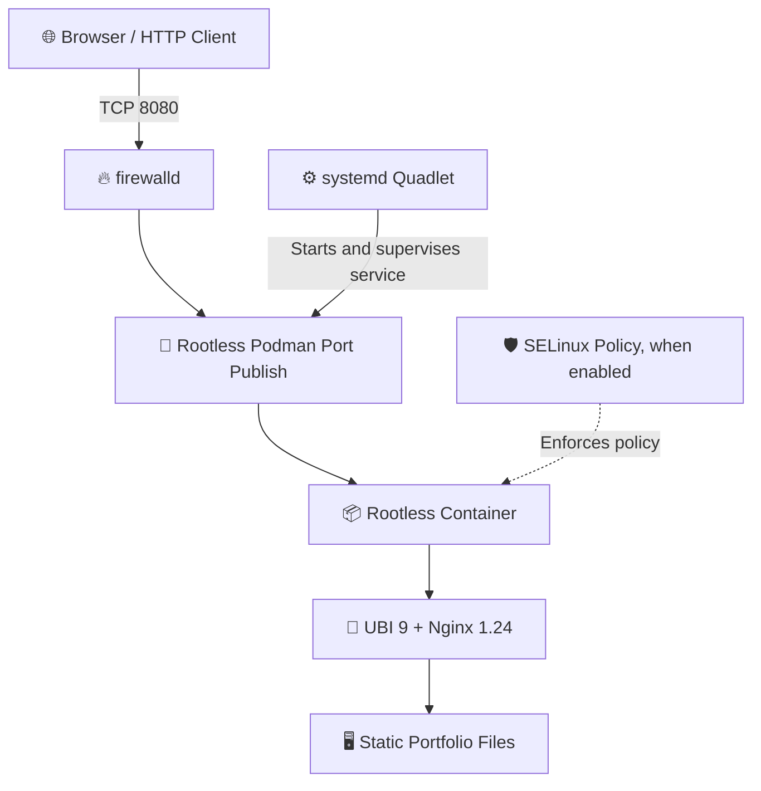

<div align="center">

# 🛡️ Enterprise-Style Rootless Portfolio Container on RHEL 9

### Secure-minded container deployment • Rootless Podman • Nginx • systemd Quadlet

A hands-on portfolio deployment project focused on running a static website with **Podman in rootless mode**, a **Red Hat UBI 9 Nginx image**, **SELinux-aware confinement**, and **systemd-managed lifecycle automation**.

<p>
  <a href="https://dakshxmahera.vercel.app"><strong>🌐 Live Portfolio</strong></a> ·
  <a href="https://github.com/dakshxndrm/podman-portfolio-container"><strong>💻 Source Code</strong></a> ·
  <a href="https://hub.docker.com/r/dakshmahera22/portfolio"><strong>📦 Docker Hub</strong></a>
</p>

<p>
  <a href="https://hub.docker.com/r/dakshmahera22/portfolio"></a>
  <a href="https://docs.redhat.com/en/documentation/red_hat_enterprise_linux/9"></a>
  <a href="https://podman.io/"></a>
  <a href="https://catalog.redhat.com/software/containers/ubi9/nginx-124/657b066b6c1bc124a1d7ff39"></a>
  <a href="https://docs.podman.io/en/latest/markdown/podman-systemd.unit.5.html"></a>
  <a href="https://docs.redhat.com/en/documentation/red_hat_enterprise_linux/9"></a>
</p>

> 🏆 **Project Context — Summer Internship 2025**  
> Developed by **Daksh Mahera** during professional training at **Red Hat / RCAT (Rajasthan Centre for Advanced Technology)**. The project demonstrates practical work with rootless containers, Linux service management, web serving, and layered host security controls.

</div>

---

## ✨ Project Highlights

<table>
  <tr>
    <td align="center" width="25%">
      <h2>🦭</h2>
      <strong>Rootless Podman</strong><br>
      <sub>Run the container without running the Podman workflow as host root.</sub>
    </td>
    <td align="center" width="25%">
      <h2>🛡️</h2>
      <strong>Layered Isolation</strong><br>
      <sub>User namespaces, container defaults, and SELinux where enabled.</sub>
    </td>
    <td align="center" width="25%">
      <h2>⚙️</h2>
      <strong>systemd Quadlet</strong><br>
      <sub>Declarative service configuration, restart policy, and startup integration.</sub>
    </td>
    <td align="center" width="25%">
      <h2>📦</h2>
      <strong>Portable Image</strong><br>
      <sub>Build locally, run on a compatible container host, and publish to Docker Hub.</sub>
    </td>
  </tr>
  <tr>
    <td align="center" width="25%">
      <h2>🏢</h2>
      <strong>Red Hat UBI 9</strong><br>
      <sub>Uses the UBI 9 Nginx 1.24 image as its application base.</sub>
    </td>
    <td align="center" width="25%">
      <h2>🌐</h2>
      <strong>Static Web Delivery</strong><br>
      <sub>Serves HTML, CSS, JavaScript, and other static assets on port 8080.</sub>
    </td>
    <td align="center" width="25%">
      <h2>🔍</h2>
      <strong>Operational Checks</strong><br>
      <sub>Inspect service status, logs, container process details, and HTTP responses.</sub>
    </td>
    <td align="center" width="25%">
      <h2>🚀</h2>
      <strong>Reproducible Setup</strong><br>
      <sub>Includes build, run, service, firewall, and registry publishing steps.</sub>
    </td>
  </tr>
</table>

## ⚡ Quick Start

Want to launch the published image first? Choose Docker or Podman.

### 🐳 Docker

```bash
docker run -d --name daksh-portfolio -p 8080:8080 dakshmahera22/portfolio:latest
```

### 🦭 Podman

```bash
podman run -d --name daksh-portfolio -p 8080:8080 docker.io/dakshmahera22/portfolio:latest
```

Open **[http://localhost:8080](http://localhost:8080)** in your browser.

| 🔗 Resource | Link |
|---|---|
| 🌐 Live portfolio | [dakshxmahera.vercel.app](https://dakshxmahera.vercel.app) |
| 📦 Container image | [Docker Hub — dakshmahera22/portfolio](https://hub.docker.com/r/dakshmahera22/portfolio) |
| 💻 Source repository | [podman-portfolio-container](https://github.com/dakshxndrm/podman-portfolio-container) |
| 🧰 Podman documentation | [podman.io](https://podman.io/) |
| 🏢 Red Hat UBI 9 Nginx image | [Red Hat Ecosystem Catalog](https://catalog.redhat.com/software/containers/ubi9/nginx-124/657b066b6c1bc124a1d7ff39) |

> **Port note:** These commands assume the published image listens on container port `8080`. If port `8080` is already in use on your machine, change the host-side port—for example, `-p 8081:8080`—and open `http://localhost:8081`.

---

## 🧠 Why This Stack?

| Capability | Implementation | Practical value |
|---|---|---|
| 🦭 Daemonless container workflow | Podman with OCI runtimes such as `crun` or `runc` | Avoids dependence on a long-running central Docker daemon for common container operations. |
| 👤 Rootless execution | Podman user namespaces and an unprivileged container workflow | Reduces the privileges available to the container-management process on the host. |
| 🛡️ SELinux-aware confinement | SELinux policy and container labels when SELinux is enabled and enforcing | Adds a host-level mandatory access-control layer alongside namespaces and other container controls. |
| ⚙️ Service lifecycle management | systemd Quadlet `.container` definition | Makes container settings declarative and integrates lifecycle/restart behavior with systemd. |
| 🏢 Base image | `registry.access.redhat.com/ubi9/nginx-124` | Provides a Red Hat Universal Base Image-based Nginx runtime. |
| 🌐 Web serving | Nginx serving static assets on port `8080` | Keeps the example lightweight and easy to reproduce. |

> 🔐 **Security note:** Containers still share the host kernel. Rootless mode and SELinux can reduce risk, but they do not make a container escape impossible or guarantee zero host access. Keep the host, image, packages, and policies updated, and validate the configuration for your environment.

---

## 📐 Architecture & Traffic Flow



### 🧩 Repository Layout

```text
podman-portfolio-container/
├── Containerfile
├── nginx/
│   └── default.conf
├── src/
│   ├── index.html
│   ├── assets/
│   ├── *.css
│   └── *.js
└── README.md
```

Your exact frontend files may differ. Put the static website files and asset folders inside `src/` before building the image.

---

## 🛠️ Build It Yourself on RHEL 9

### 1. Prepare the host

Use a registered RHEL 9 machine with access to the repositories required by your environment. Install the container tools, Git, and firewall utilities:

```bash
sudo dnf install -y container-tools git firewalld
podman --version
systemctl is-active firewalld
```

If your host is not registered or its repositories are unavailable, follow your organization's Red Hat subscription and repository setup process first.

### 2. Clone the project

```bash
git clone https://github.com/dakshxndrm/podman-portfolio-container.git
cd podman-portfolio-container
mkdir -p nginx src
```

Copy your portfolio frontend files—such as `index.html`, stylesheets, JavaScript, and `assets/`—into `src/`.

### 3. Configure Nginx routing

Create `nginx/default.conf`:

```nginx
location / {
    root   /opt/app-root/src;
    index  index.html index.htm;
    try_files $uri $uri/ /index.html;
}

# Cache static assets. For long-lived caching, prefer versioned/hashed filenames.
location ~* \.(?:css|js|jpg|jpeg|gif|png|ico|svg|webp|pdf)$ {
    root /opt/app-root/src;
    expires 30d;
    add_header Cache-Control "public";
}
```

This configuration supports client-side fallback routing. Make sure it is compatible with the Nginx configuration included in the base image before deploying it to a production environment.

### 4. Create the `Containerfile`

Create `Containerfile` in the repository root:

```dockerfile
FROM registry.access.redhat.com/ubi9/nginx-124:latest

COPY --chown=1001:0 src/ /opt/app-root/src/
COPY --chown=1001:0 nginx/default.conf /opt/app-root/etc/nginx.default.d/portfolio.conf

USER 1001
EXPOSE 8080

CMD ["nginx", "-g", "daemon off;"]
```

The image uses the UBI 9 Nginx image's application paths and runs as the non-root container user `1001`. Verify the included configuration paths and startup command against the exact base-image version you build with.

### 5. Build and test locally

```bash
podman build -t localhost/daksh-portfolio:latest .
podman run -d --name test-portfolio -p 8080:8080 localhost/daksh-portfolio:latest
curl -I http://localhost:8080
podman logs test-portfolio
podman rm -f test-portfolio
```

A successful HTTP response confirms that the service is reachable locally. If the container exits unexpectedly, inspect its logs before removing it.

### 6. Add a rootless systemd Quadlet

Create the user-level Quadlet directory:

```bash
mkdir -p ~/.config/containers/systemd
```

Create `~/.config/containers/systemd/portfolio.container`:

```ini
[Unit]
Description=Daksh Mahera Portfolio Container

[Container]
Image=localhost/daksh-portfolio:latest
ContainerName=daksh-portfolio
PublishPort=8080:8080

[Service]
Restart=always
TimeoutStartSec=900

[Install]
WantedBy=default.target
```

Reload the user systemd manager and start the generated service:

```bash
systemctl --user daemon-reload
systemctl --user start portfolio.service
systemctl --user status portfolio.service
```

To allow the user service manager to remain active after logout and start at boot, enable lingering for your account:

```bash
sudo loginctl enable-linger "$USER"
```

Quadlet generates the corresponding service from the `.container` file; the `[Install]` section defines its target relationship. Check the Podman version and the Quadlet documentation for any version-specific behavior.

### 7. Open the firewall port

If the portfolio should be reachable from other devices, open TCP port `8080` on the RHEL host:

```bash
sudo firewall-cmd --permanent --add-port=8080/tcp
sudo firewall-cmd --reload
sudo firewall-cmd --list-ports
```

For a cloud VM, also review the cloud firewall or security-group rules. Only expose the port to networks that should be able to access the site.

### 8. Publish the image to Docker Hub

```bash
podman login docker.io
podman tag localhost/daksh-portfolio:latest docker.io/dakshmahera22/portfolio:latest
podman push docker.io/dakshmahera22/portfolio:latest
```

After the push completes, check the repository on [Docker Hub](https://hub.docker.com/r/dakshmahera22/portfolio) and test pulling the image from a separate machine when possible.

---

## 🔍 Operations & Verification

| Task | Command |
|---|---|
| Check the rootless service | `systemctl --user status portfolio.service` |
| Follow service logs | `journalctl --user -u portfolio.service -f` |
| List running containers | `podman ps` |
| Inspect the container | `podman inspect daksh-portfolio` |
| View container process/user details | `podman top daksh-portfolio user huser` |
| Check SELinux mode | `getenforce` |
| Inspect host process labels | `ps -eZ \| grep nginx` |
| Test the HTTP endpoint | `curl -I http://localhost:8080` |
| Review firewall configuration | `sudo firewall-cmd --list-all` |

If Quadlet does not generate the expected service, inspect Podman/systemd logs and validate the `.container` file against the installed Podman version.

---

## 🧰 Technologies Used

<p align="center">
  
  
  
  
  
  
  
  
</p>

---

## 👨‍💻 Author

<div align="center">

### **Daksh Mahera**

*AI/ML · Data Science · RAG Systems · Software Engineering*

[](https://in.linkedin.com/in/daksh-mahera)
[](https://github.com/dakshxndrm)
[](https://dakshxmahera.vercel.app)
[](https://hub.docker.com/r/dakshmahera22/portfolio)

🎓 **Project context:** Summer Internship 2025 — Red Hat / RCAT, Jaipur.

*Built with curiosity, careful experiments, and a bias toward shipping useful things.*

</div>

---

## 📚 References

- [Red Hat Enterprise Linux 9 — Building, running, and managing containers](https://docs.redhat.com/en/documentation/red_hat_enterprise_linux/9/html/building_running_and_managing_containers/)
- [Podman Quadlet documentation](https://docs.podman.io/en/latest/markdown/podman-systemd.unit.5.html)
- [Red Hat UBI 9 Nginx 1.24 image](https://catalog.redhat.com/software/containers/ubi9/nginx-124/657b066b6c1bc124a1d7ff39)
- [Podman project](https://podman.io/)
- [SELinux documentation for RHEL 9](https://docs.redhat.com/en/documentation/red_hat_enterprise_linux/9/)

<div align="center">
  <sub>⭐ If this project helps you learn rootless containers and Linux service management, consider starring the repository.</sub>
</div>
